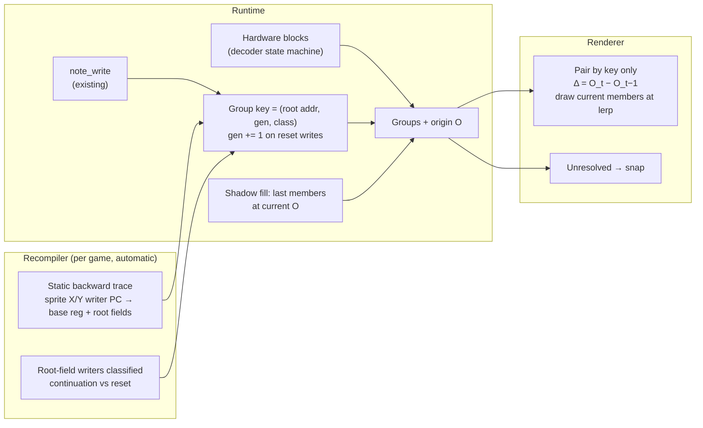

# Handoff: automatic sprite groups and identity (replacing emit units)

This is a design and evidence handoff. No runtime or recompiler code has been changed yet. The models, proofs, scripts and agent reports this document relies on are in [`handoff/sprite-groups/`](handoff/sprite-groups/).

## TL;DR

- **The current ID scheme is broken in three ways that motion code works around.** Today's sprite identity is `mix(invocation id, slot − lowest slot)`, with generations inferred from frame gaps. TLC finds a counterexample for each problem within 2 frames: flicker shifts the IDs, an LoD change pairs the wrong sprites, and an object replaced in place keeps the old key. `motion.cpp` contains about 250 lines of heuristics that compensate for these.
- **Sprite groups are rigid in both games.** Every member's position is the group origin O plus an offset that depends only on fields of the whole object (template, zoom, flip). So pairing **groups**, giving each one delta, and drawing the current frame's members is correct (proved in Bend for all values, model-checked in TLC). Per-sprite roles and IDs aren't needed.
- **Grouping and identity can be derived without per-game configuration:**
  - **Grouping:** F3 hardware blocks (commandw puts 100% of its drawn sprites in blocks). For games that don't use blocks (landmakrj uses 0%), grouping comes from the static trace below.
  - **Identity:** a static backward trace from each sprite X/Y write reaches the object record. It resolved 22/22 X/Y write instructions in landmakrj's display objects and 6/6 block-origin X/Y words in commandw.
  - **Births:** a value written into a root field that isn't computed from its previous value (pos += vel is a continuation; pos = const is a reset).
  - **Safety rule:** anything that can't be derived **snaps**. It is never guessed.
- **Emit units, the ENTER/EXIT invocation stack, IRQ-depth attribution, per-sprite IDs, flicker forcing and the `motion.cpp` heuristics can all go.** Behaviours and mods stay as manual configuration (agreed with the user): they encode what fields *mean*, which can't be derived.
- **Next step:** prototype the static tracer in the recompiler and measure its coverage against the two hand traces (see [Plan](#plan)).

---

## 1. Background: the current system

| Piece | Where | What it does |
|---|---|---|
| Emit units | `games/<id>/config.toml` `[[video.emit_units]]`, parsed by `recomp/sprite_units.py` | Hand-declared start/end PCs, record register, `size`, `owner` (`unit` or `writer`) |
| Hooks | `recomp/generate.py:230-242`, macros in `recomp/cpu_ops.h:40-41` | `F3_UNIT_ENTER`/`F3_UNIT_EXIT` before the instruction at each start/end PC. Validation at `generate.py:138-151`; liveness pinning at `:208`; digest guard in `sprite_units.py:217-221` |
| Runtime | `runtime/sprites/units.cpp` (901 lines), `units.hpp` (303) | Invocation stack, IRQ-depth attribution, sandbox replay, splices, behaviours, flicker forcing. Policies are listed in `units.hpp:21-34` |
| IDs | `units.cpp:243-259` (invocation), `:363-369` (per entry) | Unit-owned: `mix(unit\|addr, generation)`, generation += 1 after a skipped frame. Writer-owned: `mix(unit\|writer_pc, per-frame ordinal)`. Per entry: `mix(invocation, slot − lo)` |
| Write capture | `runtime/machine.cpp:184,196,242,254` → `SpriteUnits::note_write` (`units.cpp:293`) → `sprite_write` (`:307`) | Slot key = `bank*0x400 + ((offset & 0x7fff) >> 4)` (`units.cpp:25`) |
| Renderer pairing | `runtime/renderer/gpu/motion.cpp`, `capture()` lines ~72-330 | ID pass, demotion on tile change, re-keying births/vanished sprites, appearance fallback (32 px), restoration, per-object "rigid check" by mode delta. The comment at `:80-97` documents why |
| Behaviours | `runtime/sprites/behaviour.hpp`, `games/commandw/sprites/behaviours.hpp` | `FULL_DETAIL` (forces LoD 0) and `F3RT_FLICKER_SHADOW` (forces the parity gate so the shadow appears every frame) |

The game configs in use are `games/commandw/config.toml:250-283` and `games/landmakrj/config.toml:132-165`.

## 2. Problems with the current scheme (evidence)

Model: `handoff/sprite-groups/tla/SpriteGroups.tla`. It has 2 slots, 2 LoD levels (level 0 draws 2 tiles, level 1 draws 1) and one object with a shadow that is emitted before its body on odd parity. Objects die, spawn and get replaced in place, levels change, draw order shuffles and parity flips. A ghost `uid` and `role` give the ground truth.

| ID scheme / birth detection | Unique | GroupSound | GroupComplete | PairSound | PairComplete |
|---|---|---|---|---|---|
| **role / event** | ✅ | ✅ | ✅ | ✅ | ✅ |
| role / gap | ✅ | ❌ | ✅ | ❌ | ✅ |
| order / event | ✅ | ✅ | ✅ | ❌ | ❌ |
| **order / gap (today)** | ✅ | ❌ | ✅ | ❌ | ❌ |

Full exploration: 11,832 states (event), 18,976 states (gap). The counterexamples, 2 frames each:

1. **Flicker** (order, PairComplete): the parity turns on and the shadow takes offset 1, so body tile 1 moves to offset 2 and its ID changes.
2. **LoD change** (order, PairSound): the level drops while the parity turns on. The same offset (1) holds body tile 1, then the shadow, under the same ID.
3. **In-place replacement** (gap, GroupSound): a new object takes the slot in the same frame the old one dies. With no missing frame, the generation doesn't change, and the key is reused.

These match the workarounds in `motion.cpp:80-97` ("some games change the identity every other frame…", "entry k may now be a neighbouring cell of a zoomed grid…").

## 3. Model and definitions

- **S:** one drawn sprite entry (16 bytes).
- **O (origin):** a RAM *variable* (an address, not a value) that S's position depends on. ROM constants and tables are not Os.
- **SG (sprite group):** sprites whose positions depend on the same root Os. A derived value (zoom, distance, LoD level, descriptor) is a function of the roots and doesn't create a new group. A new **independent** root (a child object pointer, a per-part timer) would create a nested group. None was found in either game.
- **Rigid:** $\text{pos}_t(S) = O_t + \ell_t(S)$, where $\ell_t$ depends only on fields of the whole object (template, zoom, flip), not on per-part state. $\ell$ may change between frames (zoom, LoD), and the member set may change (LoD, skipped tiles, flicker).
- **Key:** (root address(es), generation, class). Class separates groups of the same object that have **different** roots, e.g. commandw body (`$6/$8`) vs shadow (`$44/$46`).
- **Interpolation:** pair groups by key, then $\text{pos}_\alpha(S) = \operatorname{lerp}(O_{t-1}, O_t, \alpha) + \ell_t(S)$, using the **current** frame's members.
- **Continuity (birth):** interpolate only when $O_t$ was computed from $O_{t-1}$. A write to a root field classified as a *reset* (constant, table, other source) bumps the generation. This also snaps teleports, which is the correct behaviour.
- **Safety rule:** an unresolved key → that group snaps. The design never guesses.

Visibility V can toggle (flicker) without affecting group membership or the key. The commandw shadow's origin and zoom are written every frame by `0xa1c8`, which never reads the parity byte (checked: the only parity read in the object path is the gate at `0x9b42`, `build-commandw/generated/commandw/blocks_0004.c:28272`; none in `0xa1c8–0xa2f0`).

## 4. Proofs

### 4.1 Bend (unbounded laws), `handoff/sprite-groups/bend/`

| Law | Statement | Proof |
|---|---|---|
| `rigid_delta` | $(l + O_1) - (l + O_0) = O_1 - O_0$ for all $l, O_0, O_1 \in \mathbb{N}$ | induction on $l$ |
| `birth_separates` | $g + 1 \neq g$ for all $g$ | induction, with `Equal.cong` on predecessor |
| `class_separates` | Body ≠ Shadow | rewrite through a type-valued discriminator |

- Run: `cd handoff/sprite-groups/bend && bend PROOF.bend` → `ALL PROOFS CHECK`.
- **Negative control:** `bend/neg/` states the non-rigid variant $(l + O_1) - O_0 = O_1 - O_0$. The same proof fails at the induction step, as expected.
- **Not done:** `--verdict` (the Lean-checked kernel) needs Lean v4.34.0, which isn't installed.
- **Scope:** these are the algebraic core only. Frame-by-frame behaviour is covered by TLC.

### 4.2 TLC (bounded model checking), `handoff/sprite-groups/tla/RigidGroups.tla`

Rigid groups with no roles. Body and shadow have **independent** origins. Member count depends on the LoD level. The shadow is drawn either by the parity gate (`flicker`) or every frame (`forced`, which stands for forcing or for the planned fill). Births are events. Bounds: 2 objects, 2 levels, positions {0,1}, MaxUid 9.

| Grouping / shadow  | RigidKey          | GroupSound | GroupComplete | Interpolates | ShadowSmooth |
| ------------------ | ----------------- | ---------- | ------------- | ------------ | ------------ |
| **class / forced** | ✅                 | ✅          | ✅             | ✅            | ✅            |
| class / flicker    | ✅                 | ✅          | ✅             | ✅            | ❌            |
| object / forced    | ❌                 | ❌          | ✅             | ❌            | ✅*           |
| object / flicker   | ❌ (initial state) | ❌          | ✅             | ❌            | ✅*           |

\* The pass is vacuous: the shadow gets paired with the **body's** key.

The passing runs explored all 213,504 states (forced) and 162,816 states (flicker). Raw results are in `tla/rigid_results.txt`. Five rows first returned `ERR` with empty output (TLC launch problem) and were rerun with a separate `-metadir`; the reruns are appended to that file.

What it establishes:
- **Key:** (address, generation, class) is required. With object-only keys, body and shadow share a key and get the wrong delta.
- **Shadow:** must be present every frame (forced or filled), or it can never pair between consecutive frames.
- **Fill (`ShadowMode="fill"`) passes the refined `ShadowSmooth` under class keys.** A shadow is drawn on parity frames or when the same uid had one last frame. The property now requires pairing only once an incarnation's shadow has been drawn (`drawnBefore` history), exempting frames before the first draw; it is weaker than the birth-inclusive form, which fails under fill. Under class keys (pair and snap) all six invariants pass with fill, while flicker fails `ShadowSmooth`. Object keys fail everywhere: `RigidKey` fails in all modes, `ShadowSmooth` fails under snap, and under pair it holds only through the body's key while `PairSound` fails. Counts, probes, and per-run rows: `tla/rigid_results.txt`. Full 72-run matrix wall time: 3162 s.

How to run (Homebrew OpenJDK 21 + `~/Downloads/tla2tools.jar`, TLC 2.19):

```sh
cd handoff/sprite-groups/tla
/opt/homebrew/opt/openjdk@21/bin/java -XX:+UseParallelGC -cp ~/Downloads/tla2tools.jar \
  tlc2.TLC -workers auto -deadlock -config RigidGroups.example.cfg RigidGroups.tla
# full matrix (~53 min measured wall time, 3162 s; D=/tmp/sgmodel; run 3 rows are authoritative for ShadowSmooth, earlier rows superseded only for ShadowSmooth):
python3 run_rigid.py
```

- **Configs:** `SpriteGroups.tla` takes constants `Addr, Levels, Shadowed, MaxUid, Scheme ∈ {role, order}, Birth ∈ {event, gap}`; see `SpriteGroups.example.cfg`.
- **Speed:** with `Pos = {0,1,2}` the rigid model gets slow. `{0,1}` takes about 50 s per run.

## 5. Evidence from the games

The full agent reports are in `handoff/sprite-groups/reports/`. Most of this is static analysis by Haiku with f3a, plus some runtime sampling.

### 5.1 Rigidity

- **commandw `objects`** (`reports/03`): body X/Y = record field − ROM table entry indexed by fields of the whole object (zoom, descriptor). No parent pointers, per-part angles or per-part RAM. Tiles come out row-major with no skipping of empty tiles. The **shadow is a separate projection** (own anchor and zoom, computed in `0xa268–0xa2e8`), so it's a separate group, not a rigid member of the body.
- **landmakrj display objects** (`reports/02`): 4 handlers (`0xa8f38` grid, `0xa8f84` 3-tile, `0xa90f4` 4-tile, `0xa913c` scaled). The first three were seen at runtime. Offsets are constants or template-derived; `0xa913c` scales offsets by object zoom (static reading only).
- **landmakrj queue** (`reports/01`): grid records (`0x46c0`) place tiles at fixed 0x10 steps from the record's X/Y (+8/+10), so they're rigid. Single records (`0x4688`) are one sprite. No case was found of one object pushing several records. Title (`sub_093080`) and player select (`sub_09d9f4`) use hard-coded immediate positions.

### 5.2 Hardware blocks (`reports/04`, scripts in `blockstats/`)

| Gameplay frames | commandw (382) | landmakrj (947) |
|---|---|---|
| Drawn sprites per frame, mean / max | 122 / 140 | 241 / 367 |
| Hardware blocks per frame, mean / max | 9.5 / 10 | 241 / 367 |
| Share of sprites in blocks with ≥2 members | **100%** | **0%** |

Block semantics are in `docs/notes/hardware/sprites.md:142-173`; the decoder state machine is in `runtime/renderer/decode.cpp:20-100`. Landmakrj never sets the multi bit. Dumps came from `f3rt-run --dump-dir`. Landmakrj used `--renderer accurate` (the default renderer requires strict native mode); the dump is raw sprite RAM, but this wasn't checked against other renderers.

### 5.3 Static backward trace: sprite X/Y write → record field

| Game / path | X/Y write instructions | Resolved to the record | Root fields |
|---|---|---|---|
| landmakrj grid `0xa8f38` (+ flip `0xa9036`) | 4 | 4 | `$c(a3)`, `$e(a3)` |
| landmakrj 3-tile `0xa8f84` | 6 | 6 | `$c`, `$e` |
| landmakrj 4-tile `0xa90f4` | 8 | 8 | `$c`, `$e` |
| landmakrj scaled `0xa913c` | 4 (long) | 4 | `$c`, `$e` (offsets depend on zoom: rigid under the definition above) |
| commandw shadow `0x9c90` | 1 long (X:Y) | ✅ | `$44(a6)`, `$46(a6)` |
| commandw body `0x9e9a` | 1 long | ✅ | `$6(a6)`, `$8(a6)` |
| commandw multi-part `0xa0be` | 1 long | ✅ | `$6`, `$8` |
| landmakrj queue single `0x4688` | 2 | from the queue record stream `(a4)` | +4/+6 relative to the stream (record +8/+10 assumed, not verified) |
| landmakrj queue grid tails `0x487c…` | not traced | — | the tails write `a3` itself into sprite RAM (f3a labels may be wrong there) |

- **commandw block members:** they get no X/Y writes, which fits the hardware block model.
- **Patterns a generic tracer needs** (all ordinary 68k idioms; full lists in `reports/05` and `reports/06`):
  - **Dispatch:** indirect `jmp ([$8,a3])`; return through a register (`jmp (a4)`); `jsr (a1)` jump tables whose targets only move stream pointers.
  - **Memory:** two-level pointers (`[[a3]+k]` template, base from `a3`); two-level ROM pointer tables with sign-extended indexes; reverse stream reads; loop-carried cursors.
  - **Writes:** long writes split into word lanes; data-dependent skipped writes; early-out gates; masks (`andi #$fff`) to be ignored.
  - **Branches:** add vs sub chosen by a branch → take the union of both branches' leaves.

### 5.4 Corrections to earlier claims (don't reuse these)

- **Shadow origin:** it's `$44` (X) and `$46` (Y). It is **not** a "`$44` long", and `$43` is an X table index, not a zoom.
- **X table index:** commandw's X lookup uses the **second** descriptor stream word, not `d7`.
- **Record pointer:** commandw `a6` is loaded from a RAM draw list at `0x40885a` (fallback `0x413c00` + k·0x80), not from a fixed `0x410000 + k·0x80`. The key is still the value of `a6`.
- **Bit 7 flags:** byte 0 bit 7 of a commandw record is the "object active" test at `0x9a3c`. Byte **1** bit 7 is the shadow flag (`0x9b38`). Both are real.
- **f3a labels:** f3a's sprite-address labels assume straight-line code and are wrong on branches (+16 on the landmakrj flip path).
- **Determinism:** an earlier claim that "netplay/state CRC requires byte-exact sprite RAM, so high-level calls can't replace writes" is **outdated, per the user**. Don't rely on it.

## 6. Target design

> **2026-10-25:** the shadow fill is removed. It was a single-game (commandw) heuristic over shared
> types; flicker shadows now snap in motion mode. Steps below describe the original design.



1. **Grouping:** hardware blocks where they exist (commandw). Otherwise, the writes that share a key form one group (landmakrj).
2. **Key:** for each PC that writes sprite RAM, the recompiler emits a table entry `{pc, lane (X/Y), base register, root field offsets, class}`. At runtime, `note_write` looks up the writer PC and reads the base register → root address → key. Class = which root fields it reached. No ENTER/EXIT hooks and no stack.
3. **Continuity:** the recompiler classifies every instruction that writes a root field. Read-modify-write, or a value traced back to the same field → continuation. Anything else → reset → `gen++`.
4. **Shadow / flicker:** the shadow is its own group (different root fields). On frames where it isn't drawn, draw the last drawn members at the current origin, read from RAM (written every frame, see §3). If the descriptor changed since the cache, snap that frame. On drawn frames, compare the predicted shadow with the real one and report the error. Known approximation: the anchor includes a zoom-indexed ROM term, so one frame of zoom change is uncorrected. If the error is visible, compute the term from ROM.
5. **Renderer:** pair groups by key only. Paired → one delta per group, current members drawn at $\operatorname{lerp}(O) + \ell_t$. Unpaired or unresolved → snap. Keep appearance matching only for sprites that have no key.
6. **Configuration:** behaviours and mods only (e.g. `FULL_DETAIL`), as agreed. They're optional and attach to derived groups.

### To delete once the design is working

- **Emit units:** `[[video.emit_units]]` and `[video.frame_writers]` in both game configs, `recomp/sprite_units.py`, `recomp/compile/sprite_units.py`, the hook emission and validation in `generate.py`, and `F3_UNIT_*` in `cpu_ops.h`.
- **Runtime (`units.cpp/.hpp`):** invocation stack, IRQ-depth attribution, unmatched/discarded accounting, gap-based generations, ordinals, the writer-owner mode, `m_identity`/`m_object`, and flicker forcing (`FlickerShadow`, `gate_set`, `shadow_forced`, `dense_flags`, `check_flicker`, `FlickerStats`, `FrameShadow`) with its frontend setting.
- **Renderer:** the per-entry `identity`/`object` spans in `presentation.hpp` → a `groups` span. In `motion.cpp`: the ID pass, demotion and restoration, re-keying, the rigid check, and the tests in `tests/motion_interp.cpp` that pin those heuristics.

### Open question: behaviours still use sandbox replay

`FULL_DETAIL` replays the unit from a CPU snapshot, which needs a start point. Options: keep a start hook only for units that have behaviours, or turn the behaviour into a native draw function whose parameters are the mod surface. Not decided.

## 7. Plan

| # | Step | Acceptance | Size |
|---|---|---|---|
| 1 | **Tracer prototype** (offline, in `recomp/`): find PCs that write sprite RAM (discovery log or `sprite-check` writer PCs), then trace X/Y back to `d(An)` using the patterns in §5.3. Output a JSON table | Matches the hand traces in §5.3: 22/22 landmakrj and 3/3 commandw instructions, same root fields. Report per game: resolved writes / all sprite X/Y writes | 2–3 d |
| 2 | **Continuity classifier** for root-field writers | Every writer of `$c/$e` (landmakrj) and the roots of `$6/$8`/`$44/$46` (commandw) classified; spot-check spawn vs update paths | 1 d |
| 3 | **Runtime keys and groups**: table lookup in `note_write`; block grouping in the decoder; `groups` span in `presentation.hpp` | Group count per frame matches hardware block stats (commandw ~9.5); no key shared by two objects in one frame | 1–2 d |
| 4 | **Shadow fill** plus the prediction-vs-real self-check; remove flicker forcing — **removed 2026-10-25**: the fill was dropped (single-game heuristic, too much shared wiring); flicker shadows snap | Shadow on every frame; median fill error ≤ 1 px on drawn frames | 1 d |
| 5 | **Renderer**: pair by key, one delta per group, snap otherwise; delete the heuristics and their tests | `f3rt-tool motion` runs on both games; no cross-pairing between body and shadow | 1–2 d |
| 6 | **Delete emit units** and their config; update `docs/notes/raw/docs/runtime-game-config-reference.md` and the game notes | Build is clean; `sprite-check` is replaced or retired | ½ d |
| 7 | **Extend TLC** with an "unresolved → snap" mode and a "fill" shadow mode | No wrong pairing reachable; ShadowSmooth holds under fill | ½ d |

Suggested first move: read how `recomp/generate.py` and `recomp/liveness.py` represent decoded instructions and def-use data, then build step 1 as a standalone `recomp/` analysis pass that outputs JSON without changing the generated code.

## 8. Open questions and risks

- **Tracer coverage on whole programs:** only 31 hand-picked writes have been traced. Values passing through scratch RAM or the stack across routines will be unresolved. The snap rule keeps that safe, but coverage determines how smooth the result looks.
- **Landmakrj queue:** X/Y come from the queue record stream. The key is either the record or its writer. The 136 (or 113) push sites, and whether the grid tails really store `a3`, are unverified.
- **Birth signal:** the continuity classifier hasn't been tested. Who writes commandw's draw list at `0x40885a` is untraced.
- **Block decoding contradictions** (`sprites.md:16-17`): group detection must use the same decoder as rendering.
- **Shadow fill error:** the zoom-indexed ROM term in the anchor isn't covered by moving the anchor by ΔO; measure it before computing it.
- **Behaviours and replay:** see the open question in §6.
- **f3a label bug** on branches (§5.4): worth reporting or fixing in the f3a skill.

## 9. Artifacts

| Path | Contents |
|---|---|
| `handoff/sprite-groups/tla/SpriteGroups.tla` | Model of the current scheme vs role IDs (§2) |
| `handoff/sprite-groups/tla/RigidGroups.tla`, `run_rigid.py`, `rigid_results.txt` | Rigid group model and results (§4.2) |
| `handoff/sprite-groups/bend/` | Bend laws, proofs and negative control (§4.1) |
| `handoff/sprite-groups/blockstats/` | Hardware block statistics scripts (§5.2) |
| `handoff/sprite-groups/reports/01..06` | Haiku investigation reports (queue and cards, rigidity ×2, block stats, traces ×2) |

Tools used: TLC 2.19 (`~/Downloads/tla2tools.jar`, downloaded during this session), Homebrew OpenJDK 21, `bend` (`~/.bend/bin/bend`), f3a skill, `build-*/f3rt-run`.
