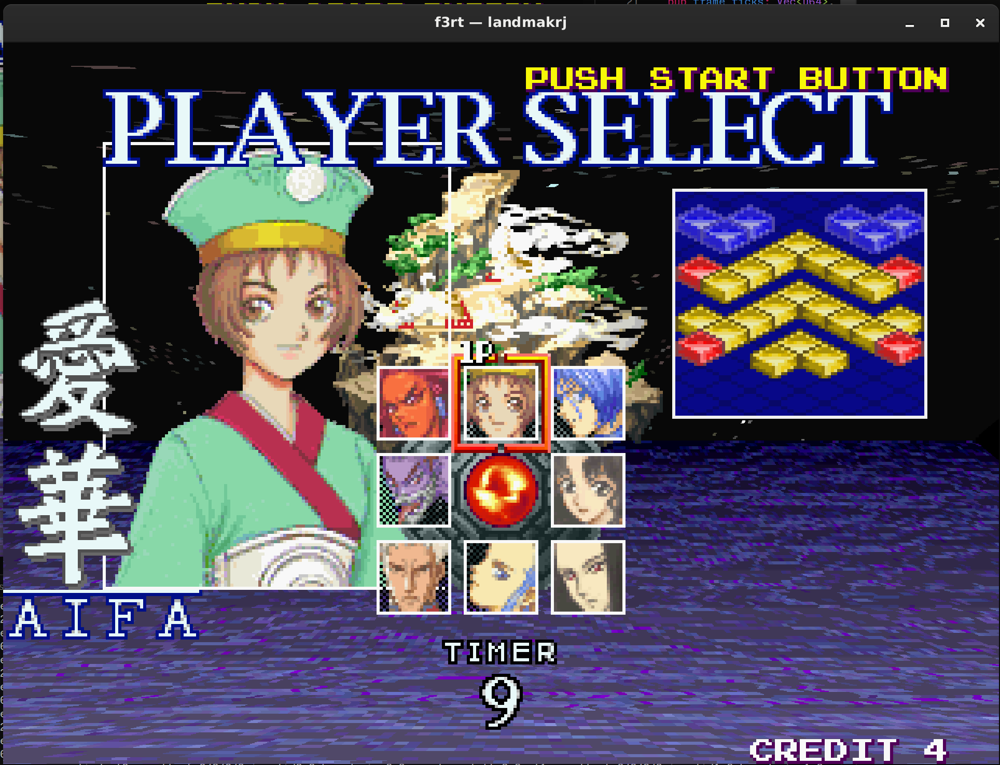

# f3-recomp

Static recompilation+runtime for Taito F3 games into native C.



## Building

> [!NOTE]
> I'm choosing to use `landmakrj` (Land Maker JAPAN) as the example simply because that's the game I'm primarily targetting and for the sake of simplicity.

My preferred method of building this on both Linux and macOS is with Nix:

```sh
nix run .#default <ROM>
# For example, to build Land Maker (JAPAN)
nix run .#default landmakrj

# Link compile_commands.json to the repo root for clangd (configures first if needed)
nix run .#compdb [<ROM>]   # defaults to landmakrj
```

Otherwise, alternative build steps are included below.

### Requirements

- CMake 3.24+
- Ninja, C11/C++20 compiler
- Rust (cargo, rustc; edition 2024). Corrosion uses a matching `cxxbridge` on `PATH` or builds the version resolved by Cargo.
- Git
- OCaml 5, Dune, and the recompiler libraries, available through `nix develop`.
- `uv` and Python 3.11+ for shader compilation and the Python tools. The Python tools install Capstone through `uv`.

### Build steps

```sh
make build GAME=landmakrj ROM_DIR=roms/landmakrj
```

### Renderer boundary

Rust records GPU work through scoped copy and render passes. Frame textures stay borrowed while
recording; the C++ host exchanges SDL handles only at the video and overlay ABI.
The headless build excludes SDL and the GPU backend.

### Renderer tests

`cargo test -p f3rt-video` runs the native renderer unit and property tests without SDL, a ROM,
or a GPU. The same suite runs as CTest's `f3rt-video-cargo-test`; C++ integration and GPU parity
remain in the runtime tests. `proptest` is a Rust dev-dependency only.

`cargo test -p f3rt-sprites` checks grouping and draw-time LoD capture against stateful
reference models. The renderer suite also checks emitted grids through the display-list
decoder. For Command War ROM parity, run `f3rt-tool sprite-check --rom-dir <dir> --frames 6000`.

## Running

```sh
./build/landmakrj/landmakrj
```

Run with `--help` for all command-line options.

## Analysis over MCP

`f3recomp mcp` is a Model Context Protocol server (stdio) for reverse-engineering a game: static analysis tools
(`disasm`, `xref`, `flow`, `inspect`, ...) plus live runtime sessions that step, poke and screenshot the recompiled
game. Run it from the repository root:

```sh
nix run .#f3-mcp          # f3recomp mcp; add `-- --game landmakrj` to list the runtime tools from the start
```

`session_open {game}` spawns `build/<game>/f3rt-tool mcp` and registers its tools as `rt_<name>`, sending
`notifications/tools/list_changed`; refresh the tool list after `session_open` and `session_close`. If the
`f3rt-tool` binary is rebuilt while a session is open, runtime calls fail until the session is reopened. The runtime
is also an MCP server on its own: `build/<game>/f3rt-tool mcp`. See `recomp/JSON-API.md` and `.omp/skills/f3mcp`.

## Supported Games

The following ROM sets have tested native builds:

- **Land Maker** (Japan 2.01J, `landmakrj`) — Full native execution, enhanced GPU presentation
- **RayForce** (America 2.3A, `rayforce`) — Native execution, 224×320 display
- **Command War** (0.0J prototype, `commandw`) — Native execution (some graphics limitations)
- **Riding Fight** (World 1.0O, `ridingf`) — Native execution (missing upper planes/sprite trails)

## Credits

- 12 and Y for the research spent on the Taito F3 + helping me learn about hardware facts for this project.
- Architecture inspired by [N64Recomp](https://github.com/N64Recomp/N64Recomp).
- Video and sound algorithms adapted from BSD-3-Clause-licensed [MAME](https://github.com/mamedev/mame) sources.

See [runtime/LICENSES.txt](runtime/LICENSES.txt) for full attribution.
