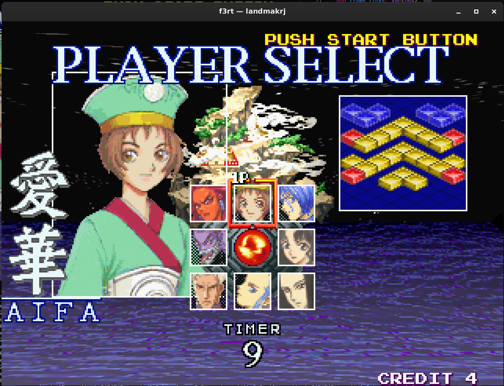

# f3-recomp

Static recompilation+runtime for Taito F3 games into native C.



## Building

> [!NOTE]
> I'm choosing to use `landmakrj` (Land Maker JAPAN) as the example simply because that's the game I'm primarily targetting and for the sake of simplicity.

My preferred method of building this on both Linux and macOS is with Nix:

```sh
nix run .#default <ROM>
# For example, to build Land Maker (JAPAN)
nix run .#default landmakrj

# Link compile_commands.json to the repo root for clangd (configures first if needed)
nix run .#compdb [<ROM>]   # defaults to landmakrj
```

Otherwise, alternative build steps are included below.

### Requirements

- CMake 3.24+
- Ninja, C11/C++20 compiler
- Rust (cargo, rustc; edition 2024)
- Git
- `uv` (managing Python 3.11+ and Capstone 5.0.9).

### Build steps

```sh
make build GAME=landmakrj ROM_DIR=roms/landmakrj
```

## Running

```sh
./build/landmakrj/landmakrj
```

Run with `--help` for all command-line options.

## Supported Games

The following ROM sets have tested native builds:

- **Land Maker** (Japan 2.01J, `landmakrj`) — Full native execution, enhanced GPU presentation
- **RayForce** (America 2.3A, `rayforce`) — Native execution, 224×320 display
- **Command War** (0.0J prototype, `commandw`) — Native execution (some graphics limitations)
- **Riding Fight** (World 1.0O, `ridingf`) — Native execution (missing upper planes/sprite trails)

## Credits

- 12 and Y for the research spent on the Taito F3 + helping me learn about hardware facts for this project.
- Architecture inspired by [N64Recomp](https://github.com/N64Recomp/N64Recomp).
- Video and sound algorithms adapted from BSD-3-Clause-licensed [MAME](https://github.com/mamedev/mame) sources.

See [runtime/LICENSES.txt](runtime/LICENSES.txt) for full attribution.
