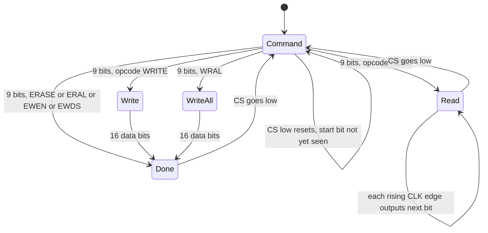

<!-- excerpt: docs/site/guide/running.md lines 52-99 -->
## Settings and the EEPROM

The arcade board stores the game settings in a small EEPROM chip (a 93C46 with 64 words of 16 bits).

By default the program does **not** keep the EEPROM. Each start begins with an erased chip, and the game writes its factory defaults again.

Use `--eeprom FILE` to keep the settings between runs.

```sh
./build/landmakr --eeprom build/landmakr.nv
```

| Situation | Result |
| --- | --- |
| The file does not exist | The program starts with an erased EEPROM. |
| The file exists and has exactly 128 bytes | The program loads it. |
| The file exists and has another size | The program stops with `Invalid EEPROM file: PATH`. |
| The run ends normally | The program writes the file. |
| The run stops with an error | The program does not write the file. |

A normal end is the `Escape` key, a closed window, or the end of a `--frames` limit.

The file has 128 bytes. It stores the 64 words as big-endian 16-bit values. A new file is all `0xff` until the game writes to it.

## Fast boot

A window launch runs the power-on self-test and boot waits at full speed by default, without drawing the frames and with the sound samples discarded. The machine executes the same frames as an ordinary power-on. Fast boot is host-side only: it does not patch the ROM, change the CPU start, or write game RAM.

Fast boot does not alter emulation: with the same build, ROMs, EEPROM contents and inputs, `frame_crc` is the same with fast boot on or off. Because fast boot also loads the initialised EEPROM below, compare against an ordinary run given that file with `--eeprom`. Builds whose game provides no boot signal never fast boot.

| Option | Default | Effect |
| --- | --- | --- |
| `--fast-boot on\|off` | `on` for a window | Run the boot frames without presentation. `--fast-boot off` restores the ordinary throttled boot. |
| `--boot-cache on\|off` | `off` | Also store the post-boot state and skip the boot frames on later launches. |

The F1 menu adds **Fast boot** and **Boot state cache** in the Save states panel. They take effect on the next launch and are written only by **Save preferences**. Explicit CLI flags override the saved values.

Fast boot is used only when nothing needs the per-frame output. A headless run ignores it unless you pass `--fast-boot on` explicitly, and it is disabled whenever `--wav`, `--dump-dir`, `--profile-out` or `--fallback-report` is given.

Fast boot prints one `fast_boot frames=N ms=T source=turbo|cache eeprom=generated|loaded|none` line before the summary.

### Initialised EEPROM

When fast boot is active and no `--eeprom` file is given, the program keeps an initialised 128-byte EEPROM at `eeprom/landmakrj-init.bin` beside the config file (the same base as `states/`). It records the game's own factory defaults, captured when boot completes and before any input. The first fast-boot launch that reaches boot completion writes it; a launch that quits or stops earlier writes nothing. Later launches load it, which skips the game's blank-EEPROM initialisation reboot (about 300 frames), so boot completes at frame 478 instead of 781.

### Boot state cache

With **Boot state cache** on (or `--boot-cache on`), the program also stores the post-boot machine state at `boot/landmakrj.state` beside the config file. A later launch loads it and skips the boot frames entirely. The cache is accepted only when the build, ROMs, state format and presentation geometry match; otherwise it is ignored, the boot runs normally, and the cache is rewritten. The state is captured at boot completion, before any input, so it is deterministic.

<!-- excerpt: docs/site/developer/runtime/input-and-eeprom.md lines 94-199 -->
## The EEPROM

The game stores its settings and high scores in a 93C46 serial EEPROM. The chip has 64 words of 16 bits. The class `f3rt::Eeprom` models it. It has one public array, `words`. The array starts as `0xffff` in all words.

### Pins

The CPU controls the EEPROM through one byte at `0x4a0013`. `Machine::write8` calls `eeprom->pins(v, cpu.cycles)`.

| Bit | Mask | Pin |
| --- | --- | --- |
| 4 | `0x10` | CS (chip select) |
| 3 | `0x08` | CLK (clock) |
| 2 | `0x04` | DI (data in) |

The data-out pin (DO) is read through `input_word(0)` as bit 0 of the system byte. The value comes from `Eeprom::output(now)`.

### Time is absolute

EEPROM time uses absolute 16 MHz main cycles.
The EEPROM receives `cpu.cycles` directly.
It does not require `advance_to`.
The model updates `words` when it receives the last data bit or decodes an erase command.
`ready_at` models the subsequent busy interval, not a deferred data commit.
Busy polling needs no further clock edges.

| Operation | Cycles | Time at 16 MHz |
| --- | --- | --- |
| Write one word | 28 000 | 1750 microseconds |
| Erase one word | 16 000 | 1000 microseconds |
| Write all, erase all | 128 000 | 8000 microseconds |

`docs/developer/DECISIONS.md` says these values match the observed baseline model. It also says that EEPROM busy timing removed a seven-frame lead in the cold boot.

### The protocol

`pins()` decodes the pin byte. A rising edge of CLK while CS is high calls `edge(bit, now)`.

- CS low: the chip is deselected. The code sets `selected = false`, remembers the clock level and resets the command state.
- CS goes from low to high: the chip is selected and the command state is reset.
- CLK rising edge: process one bit.

A command has nine bits: one start bit, two opcode bits, and six address bits.
The CPU sends the most significant bit first.
While `count == 0`, command mode ignores zero start bits.
It also ignores new start bits while `now < ready_at`.
The busy check applies to idle command mode, not to every serial edge in every mode.

After 9 bits the code decodes `shift`:

| Opcode (bits 7-6) | Name | Action |
| --- | --- | --- |
| 2 | READ | Set `address = shift & 63`. Go to read mode. DO is 0 (the dummy bit). |
| 1 | WRITE | Go to write mode. Collect 16 data bits. |
| 3 | ERASE | If write is enabled: `words[address] = 0xffff`, `ready_at = now + 16000`. Then done. |
| 0 | Misc | Decode the top two address bits, see below. |

For opcode 0, `address >> 4` selects the command:

| `address >> 4` | Name | Action |
| --- | --- | --- |
| 0 | EWDS | `writable = false`. Done. |
| 1 | WRAL | Collect 16 data bits and write them to all words. |
| 2 | ERAL | If writable: all words become `0xffff`, `ready_at = now + 128000`. Done. |
| 3 | EWEN | `writable = true`. Done. |

**Read mode.** On each next rising edge, the chip sets DO to the next bit of `words[address]`, MSB first. After 16 bits the address goes up by one and wraps from 63 to 0. So a sequential read reads the whole chip.

**Write modes.** The chip collects 16 bits. At the 16th bit, if `writable` is true, it writes the word. A single write sets `ready_at = now + 28000`. WRAL sets `words` all to the value and `ready_at = now + 128000`. If `writable` is false, nothing changes. The mode then becomes `Done`.

**Done.** The chip ignores clock edges until CS goes low.

**Power-on.** `writable` is false. A write only works after EWEN.

### Data out

`output(now)` returns:

- `now >= ready_at` when the chip is selected, in command mode, and `count == 0`. This is the ready/busy poll. A game raises CS and reads DO to check if the last write ended. DO is 0 while busy and 1 when ready.
- `data_out` in every other case.

When the chip is not selected, the `selected` flag is false and `data_out` is 1. So DO is pulled high when the chip is deselected.



### Reset and persistence

- `Eeprom::reset()` clears the serial state (`selected`, `old_clock`, `writable`, `ready_at`, the command). It keeps `words`. `Machine::reset()` calls it. `reset_devices()` calls `pins(0, ...)` which only deselects.
- `Eeprom::load(path)` reads a 128-byte file of 64 big-endian words. It does nothing if the file does not exist. It throws `Invalid EEPROM file` if the size is not 128 bytes.
- `Eeprom::save(path)` writes the 128 bytes.
- `--eeprom FILE` loads at startup and saves at normal exit.
- `save_state` and `load_state` write the words and the serial state as one packed record (`CanonicalEeprom`).

During the first boot the game ROM writes the whole EEPROM, including a checksum `$85ac`. The runtime does not seed the data or skip the check. `docs/developer/DECISIONS.md` records that wrong scheduling once left `$ffff` there and the game showed `PUSH TEST SWITCH`.

<!-- excerpt: docs/developer/DECISIONS.md lines 29, 36, 40 -->
- Native boot exposed a scheduling requirement: the nominal four-tick model reached `PUSH TEST SWITCH`; reference opcode costs instead initialized EEPROM checksum `$85ac`, reached the animated Japanese tutorial at frame 3600, and produced nonzero audio (peak 312). This is a real boot change, not EEPROM seeding or bypassing the ROM check.

- Root strict native execution with runtime `f02355d` completed 4,800 frames, 69,190,209 native blocks, zero fallback instructions, and nonzero audio peak 1252 (`build/native-final.wav`). Same-index frame comparison still differed; dense capture proved MAME frame 1080 equals native frame 1073 RGB-exact. Runtime EEPROM lacks the MAME-observed 1.75 ms per-word busy interval; 64 startup writes account for roughly this seven-frame lead. Runtime peer owns the busy-timing fix; no artificial frame offset or boot delay is being added.

- Independent EEPROM bus traces match all 21,021 pin values. The first persistent timing lead starts when an IRQ interrupts an EEPROM busy poll: native at tick 32,024,261, MAME at 32,030,481. ISR durations agree within 24 ticks; the 6,220-tick entry difference is six raster scanlines. MAME `screen.cpp` sets `m_vblank_start_time=0` and measures beam position relative to vblank (lines 332, 1013–1032, 1075–1087). Runtime instead scheduled its first IRQ after 256 scanlines from line zero rather than after a complete 262-line period. Runtime peer owns the epoch correction and verification. No EEPROM-delay, RNG, or arbitrary audio compensation is introduced.
